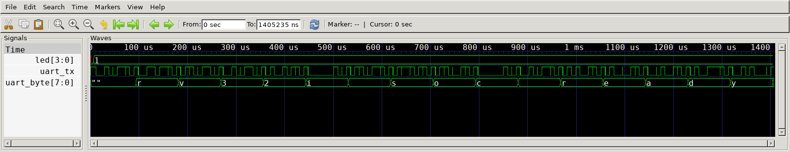

# FPGA evidence

[Documentation index](README.md) · [SoC guide](soc.md) · [Evidence ledger](evidence.md)

## Result — 2026-10-20

Vivado 2025.2 synthesized and routed the current SoC snapshot for the Arty A7-35T,
generated a bitstream, and met the specified clock constraints. XSim then executed
the firmware through the SDF-annotated, post-implementation timing netlist. The
complete UART boot banner and initial LED value passed the testbench checks.

| Measurement | Result |
|---|---:|
| FPGA part | `xc7a35ticsg324-1L` |
| Input / SoC clock | 100 MHz / 50 MHz |
| Worst setup slack / hold slack | +1.847 ns / +0.037 ns |
| Failing setup / hold endpoints | 0 / 0 |
| LUTs | 9,935 / 20,800 (47.76%) |
| Registers | 10,910 / 41,600 (26.23%) |
| Block RAM tiles | 20 / 50 (40%) |
| Boot result | `rv32i soc ready\n`, LED = `1` |



This is a native GTKWave screenshot of the XSim-generated VCD, with the decoded
`uart_byte` shown as ASCII. The signals have not been redrawn. The testbench
checks all 16 bytes, including the final newline, before reporting success:

```text
UART verified: rv32i soc ready
LED verified: 1
PASS Arty A7 post-route timing simulation
```

## Original tool output

- [XSim transcript](evidence/fpga-2026-10-20/simulate.log) and [VCD](evidence/fpga-2026-10-20/timing-boot.vcd)
- [Timing summary](evidence/fpga-2026-10-20/timing_summary.rpt), [utilization](evidence/fpga-2026-10-20/utilization.rpt), [clocks](evidence/fpga-2026-10-20/clocks.rpt), and [DRC](evidence/fpga-2026-10-20/drc.rpt)
- [Vivado log](evidence/fpga-2026-10-20/vivado.log), [source/artifact manifest](evidence/fpga-2026-10-20/manifest.json), and [local source changes](evidence/fpga-2026-10-20/source-changes.patch)
- [RTL SoC regression log](evidence/fpga-2026-10-20/soc-check.log), which additionally covers two button interrupts and return from `MRET`

This is a working-tree measurement based on `e7c571aca752`, including the local
predictor/frontend edits. Each staged source and generated artifact has a recorded
SHA-256. The bitstream, routed checkpoint, timing netlist, and SDF remain in
`build/soc/eda-2026-10-20/`; the manifest also records the retained Vivado project.
No commit or physical-board result was created by the experiment.

## What remains unproven

The board has not been programmed or manually tested in this run. Post-route
simulation covers **boot**, while button/interrupt behavior is covered by the
separate RTL simulation. Clock timing closure does not cover the external I/O:
buttons and the LED/UART output ports are false-pathed in the board constraints.

Vivado reported no DRC errors or critical warnings, but retained warnings need
attention before claiming hardware readiness:

- `CFGBVS-1`: configuration-bank voltage properties are not specified.
- `REQP-1839`: asynchronous-reset-driven BRAM control pins can affect memory
  behavior during reset assertion. That event is not covered by default STA.
- `CHECK-3`: the report capped the BRAM-control warnings at 20 instances.

The successful boot test does not resolve those reset/configuration concerns.
The original [Vivado Device image](images/soc-vivado-device.png) and its +2.009 ns
WNS belong to the earlier `d21ecd3fe310` implementation. The [core synthesis
matrix](evidence.md#historical-core-synthesis-matrix) uses a different top and a
2 ns constraint. Neither is substituted for this run's results.

## Reproduce

With the native RISC-V toolchain and Vivado 2025.2 installed:

```bash
make soc-firmware
python3 -m synthesis.soc.run_snapshot --output build/soc/eda-new-run
```

Use a new output directory for each run. The script retains exact staged inputs,
full EDA reports, and the project directory. The clean-commit publication flow
remains `make soc-bitstream` and `make soc-post-route-sim`.

Open the retained trace with the same signal selection:

```bash
cd docs/evidence/fpga-2026-10-20
gtkwave timing-boot.vcd timing-boot.gtkw -r gtkwaverc -S view.tcl
```

If the client detaches while Vivado continues, collect a completed run with
`python3 -m synthesis.soc.run_snapshot --output build/soc/eda-new-run --collect-existing`.
The collector checks staged-source hashes, the XSim/Vivado success markers,
constraints, SDF annotation, and artifact freshness before accepting the result.
