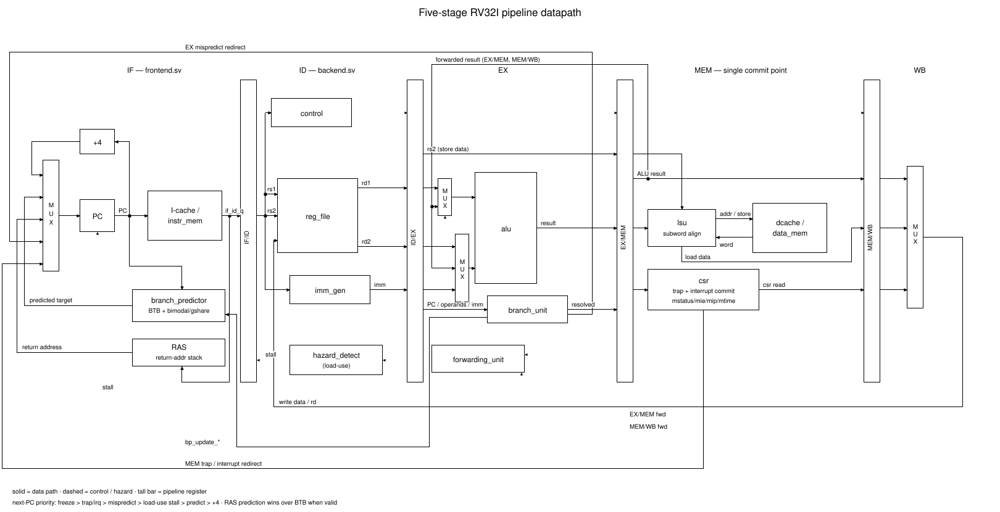
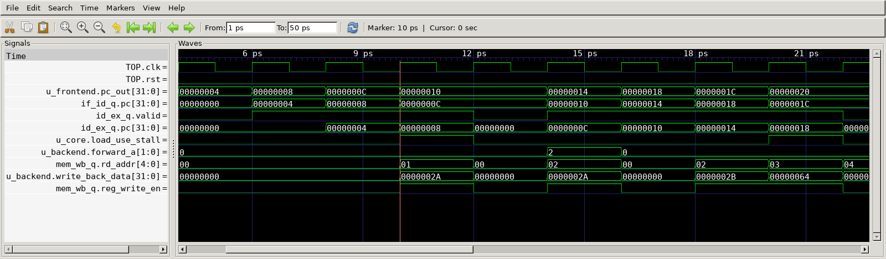
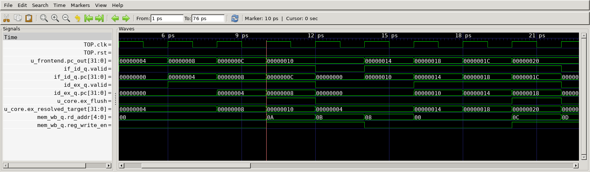
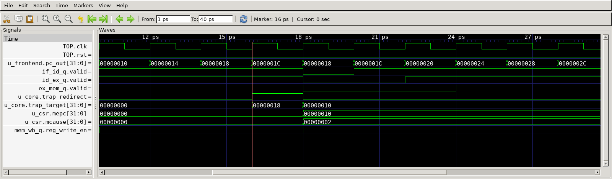
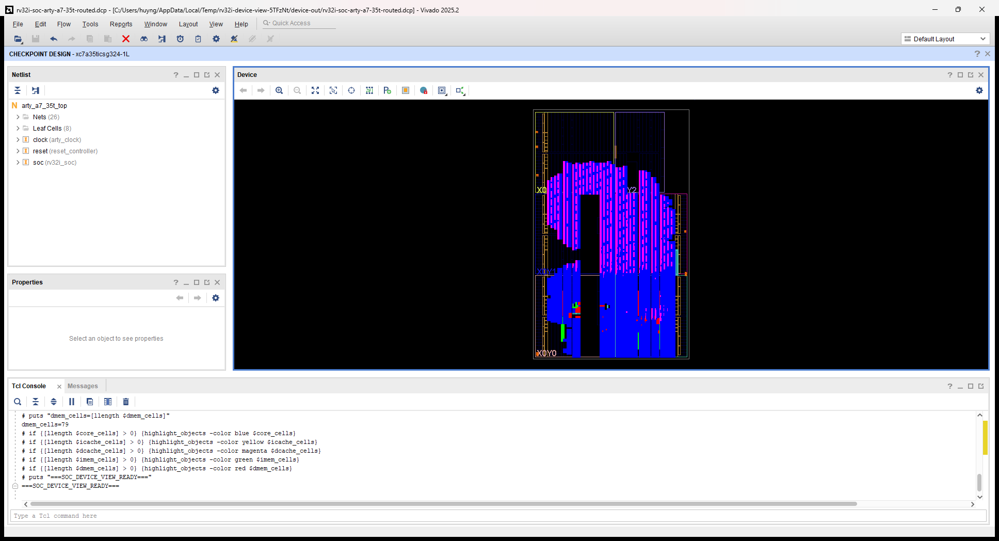

# VeriCore project visuals

Native GTKWave captures and the original Vivado screenshot. Core waveforms use Verilator testbench time; the FPGA boot trace uses XSim timing simulation. The FPGA boot transcript and source manifest are retained in reference/fpga-simulate.log and reference/fpga-manifest.json.

[PDF](portfolio.pdf) · [HTML gallery](index.html)

## Original project datapath



Existing architecture diagram from the repository.

## FPGA firmware boot — XSim post-route timing simulation


2026-10-20: SDF-annotated FPGA netlist, 50 MHz SoC constraint, +1.847 ns setup slack. UART boot and LED checks passed; DRC warnings remain in the FPGA report.

## Load-use hazard



GTKWave screenshot of t07_load_use.vcd; directed test passed.

## Branch recovery



GTKWave screenshot of t04_branch.vcd; directed test passed.

## Illegal-instruction trap



GTKWave screenshot of t09_trap_illegal.vcd; directed test passed.

## Original Vivado Device view



Historical routed SoC: 50 MHz constraint, +2.009 ns WNS. RTL d21ecd3fe310. No physical-board claim.

## Reproduce

The screenshots are unedited captures of GTKWave's application window.
No waveform has been redrawn. The original datapath is a conceptual diagram.
Raw VCDs, simulator logs, signal selections and source hashes are in `evidence/`.
The Vivado image and its metadata are copied byte-for-byte from `docs/images/`.

Open a trace with the same view:

```bash
cd docs/portfolio/evidence
gtkwave t07_load_use.vcd t07_load_use.gtkw -r gtkwaverc -S t07_load_use-view.tcl
```

Recapture all three GTKWave windows on Linux with an X11 display:

```bash
python3 tools/capture_portfolio.py
```

The script uses GTKWave, xwininfo and the GTK2 libraries; Chromium exports the PDF.
These three directed runs are not a new full-suite or synthesis validation.
